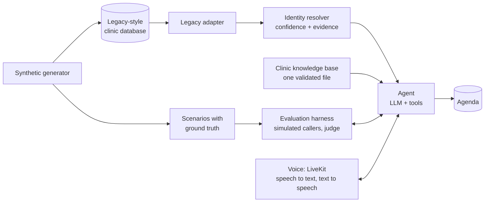

# vet-front-desk-agent

**A voice AI front desk for veterinary clinics that knows when it does not know who is
calling.**

It answers the phone, works out who the caller is and which animals they have from the
clinic's old practice-management database, answers questions from the clinic's own
information, and books, moves or cancels appointments. Spanish, Catalan and English by
voice; German, French, Italian and Russian measured by text.

**[▶ Call the demo from your browser](DEMO_URL)**: pick who you are, press *Call*, and try
to get it to tell you something that is not yours.

---

## The problem

Veterinary practice-management systems are old. In the kind this project models, an
animal is linked to its owner by the owner's **name**, not by a key. There are namesakes,
phone numbers that changed hands years ago, families sharing one phone, and names that
speech recognition gets wrong, all the more in Catalan.

A naive agent takes the first database match, greets the wrong person and tells them
about someone else's dog. So this project treats identification as **identity resolution
with a confidence level**, not a `SELECT`, and measures one number above all others:

> **False identifications: zero.** Below that comes everything else, including how often
> it identifies the caller at all.

## Results

| What was measured | Result |
|---|---|
| Identity resolver, 174,567 simulated calls over eleven generated clinics | **0 false identifications**, 97.7% identified |
| Whole calls played by simulated callers (text, with simulated speech-recognition errors), every full run | **0 false identifications**, 0 other clients' data revealed |
| Bookings, moves and cancellations done as asked (Gemini 3.5 Flash Lite, 82 calls) | 60 of 63 |
| Time to the agent's first words (same run) | median **1.2 s**, 94% under 1.5 s |
| Model cost per call | about **$0.01** |
| Calls about a symptom: emergency number given unasked, or the agent choosing for the caller | **0** of 35 |
| Voice, from the caller falling silent to hearing the answer (LiveKit, ElevenLabs speech) | 1.7 to 2.2 s |
| Tests | 683, none of them needing a model or a network |

The model was chosen with these scenarios: ten models from four providers, the same
eighty-two calls, and the decision made on speed once identity was equal. Methods, full
tables and caveats in [docs/evaluation.md](docs/evaluation.md) and
[docs/identity-resolution.md](docs/identity-resolution.md).

## How it works



| Piece | What it does |
|---|---|
| **Synthetic generator** | Builds a clinic database *with the defects of a real one* (link by name, namesakes, stale phones, typos, Catalan names in their Castilian form) and, from the same seed, call scenarios with their correct outcome |
| **Legacy adapter** | Reads the old schema and translates it into a clean model. Another practice-management system would be another adapter |
| **Identity resolver** | Plain code, no LLM. Given a number, a name, a pet and a town, returns `resolved`, `ask` (and what to ask) or `not_found`, with the evidence for every candidate |
| **Agent** | An LLM with tools (identify, pets, availability, book, list, cancel, reschedule, take a message, transfer). Provider-agnostic: Gemini, Claude and anything with OpenAI's chat format |
| **Evaluation harness** | Plays every scenario as a whole call: an LLM plays the caller, names are garbled as speech recognition would, code checks what code can, a judge model reads the rest |
| **Voice** | LiveKit carries the call; a program of ours handles turns, interruptions and hanging up, and asks the same agent the harness measures |

## Decisions that came from measuring

Each of these started as something left to the model, failed in a measured run, and was
moved into code.

- **The privacy barrier is code, not prompt.** Tools that touch a client's data fail until
  the resolver has confirmed the caller. The model decides what to say, not what it may
  know.
- **A phone number alone never confirms anybody.** A name has to match, *and* something
  corroborate it: the calling number on that record, or a pet name together with the town.
  The first policy passed every scenario and still confirmed the wrong person in the
  10,800-call sweep; four rules exist only because measuring found them.
- **Evidence counts only in the caller's own words.** The tool rejects a name, a pet or a
  town the caller never said, and a reason for the visit the caller never gave.
- **Cancelling or moving needs a call from a phone on the record.** A model once passed a
  friend's name, pet and town as the caller's own and cancelled the friend's appointment.
  The words were the caller's, so no check on the evidence could catch it; the phone can.
- **Whatever the caller will act on is computed by code.** Times, phone numbers and
  spellings come out of the tools already in words. Told how to say half hours in Catalan,
  the model turned 16:30 into "les cinc i mitja" (17:30) in six calls.
- **A prompt fix is measured before it is trusted.** That instruction turned one failure
  into six.
- **A weaker model is a better test.** A faster, less obedient model showed where the
  guarantee still rested on the model; those were fixed in code, not by switching back.
- **The agent does not triage.** It never says whether something is urgent. Whoever asks
  for the emergency number gets it at once; whoever describes a symptom is offered the
  number, a note for the vets or an appointment, and chooses. Left to the model, it gave
  the number unasked to what sounded serious (12 of 12) and booked what sounded mild.
- **No promise without a tool.** "I'll put you through" exists only when a transfer tool
  does, and the sentence itself comes from the tool's response.
- **Language is decided by code** from the caller's words. Left to the model, it answered
  Catalan speakers in Spanish a third of the time.

## Voice

The same agent was put behind three voice stacks and compared on the same calls:

| | ElevenLabs Agents | Vapi | LiveKit + our own program |
|---|---|---|---|
| Caller silent → agent's voice | 2.1 s | 2.5 s | **1.7 to 2.2 s** |
| Voice cost per minute | $0.033 | $0.065 | **≈ $0.011** (estimated) |
| "Diego Esteve Planas" heard right | No, asked to spell | No, asked to spell | **Yes, three times out of three** |
| Who handles turn-taking | The platform | The platform | Our program |

None of them gets the platform's own model or prompt: the platform asks our server, and
what answers is the agent with the privacy barrier in code. The public demo runs on
LiveKit Cloud with Google's speech services instead of ElevenLabs'; its latency is not in
this table. Details in [docs/voice.md](docs/voice.md).

## Run it locally

Requires [uv](https://docs.astral.sh/uv/) and Python 3.12.

```bash
uv sync
uv run vetdesk generate --seed 42        # the synthetic clinic and its scenarios
uv run vetdesk scenarios explain S-031   # one call, told as a story
uv run vetdesk legacy inspect            # what the adapter has to work around
uv run vetdesk identity eval             # the resolver, measured (no model, no cost)
uv run pytest
```

To talk to the agent you need a Gemini API key in `.env` (see `.env.example`); the harness
also uses Claude as its judge.

```bash
uv run vetdesk chat --number +34618065507 --verbose
uv run vetdesk eval run --per-category 1 --no-judge
```

Deploying the voice server and the browser demo: [docs/deploy.md](docs/deploy.md).

## Repository

| Path | |
|---|---|
| `src/vetdesk/synth` | Synthetic clinic and scenario generator |
| `src/vetdesk/legacy` | Adapter for the legacy database |
| `src/vetdesk/identity` | Identity resolver |
| `src/vetdesk/agent`, `kb`, `scheduling`, `llm` | Agent, knowledge base, agenda, model adapters |
| `src/vetdesk/evals` | Evaluation harness |
| `src/vetdesk/voice` | Voice server, LiveKit program, browser demo |
| `docs/` | How each part works, what was measured, and a log of every session |

About 15,000 lines of Python and 8,000 of tests, built in three weeks.

## What is not solved

- Two different people can share a full name and a pet name. Of 220,000 simulated
  non-client callers, 8 did; asking for the town left 3.
- Callers, speech recognition errors and the judge are simulated; each scenario is played
  once per run.
- German, French, Italian and Russian are measured by text only, and nobody who speaks
  them has read what the agent says.
- Whether a front desk like this falls under the EU AI Act's high-risk uses (emergency
  call triage) is a question for a lawyer, not for code. The design avoids triage on
  purpose.

## Rules of the house

- **All data is synthetic.** Names are random combinations from word lists and phone
  numbers are random digits; any resemblance to a real person or number is accidental.
  The clinic, "Planeta Animal", is fictional.
- Written from scratch, with no code carried over from earlier projects.

## Built with AI assistance

Developed with an AI coding assistant (Claude Code). Design decisions, review and
direction are the author's: [Nicolás Barceló](https://github.com/ferreret).

## License

MIT. See [LICENSE](LICENSE).
