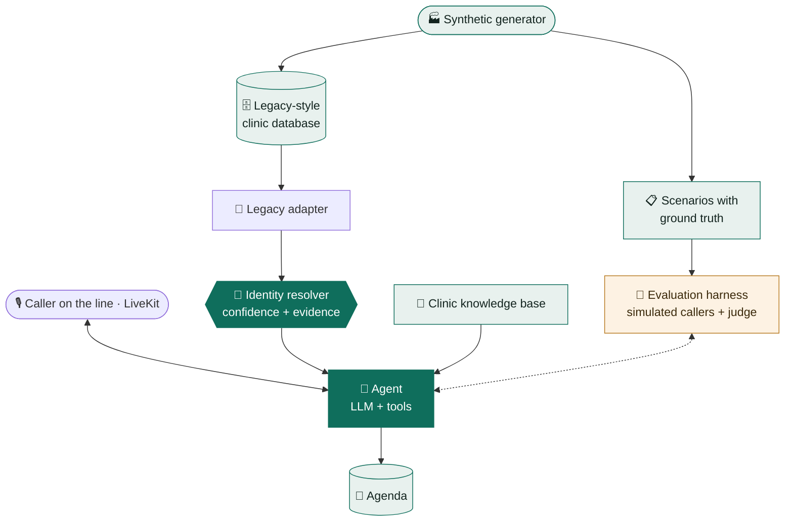

<div align="center">

# 🐾 vet-front-desk-agent

### A voice AI front desk for veterinary clinics<br/>that knows when it does **not** know who is calling.

[](https://demos.nicolasbarcelo.dev/clinica-veterinaria/)


🗣️ Spanish · Catalan · English by voice &nbsp;·&nbsp; 💬 German · French · Italian · Russian by text

</div>

---

It answers the phone, works out **who is calling and which animals they have** from the
clinic's old practice-management database, answers questions from the clinic's own
information, and **books, moves or cancels appointments**.

> [!TIP]
> **Try to fool it.** In the demo you pick who you are: a client calling from their own
> phone, from a hidden number, from somebody else's phone, or somebody who is not a client
> at all. Then try to get it to tell you something that is not yours.

> [!NOTE]
> **The demo runs on free tiers**: LiveKit Cloud's free plan carries the call, hears and
> speaks, and Gemini answers on its free API tier. If the demo does not answer, this
> month's free use has probably run out. [Get in touch](https://portfolio.nicolasbarcelo.dev/contact) and I will show it to
> you live. It **speaks Spanish only**: its free voice is a Spanish one, and Catalan said
> through it did not hold up. Catalan and English were heard on a phone line with
> ElevenLabs' voice.

## 🤔 The problem

Veterinary practice-management systems are old. In the kind this project models, an
animal is linked to its owner by the owner's **name**, not by a key. So there are:

- 👥 **namesakes**, and parents and children stored under one surname;
- 📱 **phone numbers** shared by a whole family, or that changed hands years ago;
- 🗣️ **names that speech recognition gets wrong**, all the more in Catalan.

A naive agent takes the first database match, greets the wrong person and tells them
about someone else's dog. Here, identification is **identity resolution with a confidence
level**, not a `SELECT`, and one number matters above all others:

> [!IMPORTANT]
> **False identifications: zero.** Everything else, including how often it identifies the
> caller at all, comes second.

## 📊 Results

<table>
<tr>
<td align="center" valign="top" width="25%"><h2>0</h2>false identifications<br/><sub>in 174,567 simulated calls</sub></td>
<td align="center" valign="top" width="25%"><h2>97.7%</h2>callers identified<br/><sub>of those who could be</sub></td>
<td align="center" valign="top" width="25%"><h2>1.2 s</h2>to the first words<br/><sub>median, model only</sub></td>
<td align="center" valign="top" width="25%"><h2>$0.01</h2>model cost<br/><sub>per call</sub></td>
</tr>
</table>

| What was measured | Result |
|---|---|
| 🔐 Identity resolver, 174,567 simulated calls over eleven generated clinics | **0 false identifications**, 97.7% identified |
| 🎭 Whole calls played by simulated callers, with simulated speech-recognition errors | **0 false identifications** in every full run, 0 other clients' data revealed |
| 📅 Bookings, moves and cancellations done as asked (82 calls) | 60 of 63 |
| ⚡ Time to the agent's first words (same run) | median **1.2 s**, 94% under 1.5 s |
| 🚑 Calls about a symptom: emergency number given unasked, or the agent choosing for the caller | **0** of 35 |
| 🎙️ Voice, from the caller falling silent to hearing the answer | 1.7 to 2.2 s |
| ✅ Tests | 684, none of them needing a model or a network |

The model was **chosen with these same scenarios**: ten models from four providers, and
the decision made on speed once identity was equal. Methods, full tables and caveats in
[docs/evaluation.md](docs/evaluation.md) and
[docs/identity-resolution.md](docs/identity-resolution.md).

## 🧩 How it works



| | Piece | What it does |
|---|---|---|
| 🏭 | **Synthetic generator** | Builds a clinic database *with the defects of a real one* (link by name, namesakes, stale phones, typos, Catalan names in their Castilian form) and, from the same seed, call scenarios with their correct outcome |
| 🔌 | **Legacy adapter** | Reads the old schema and translates it into a clean model. Another practice-management system would be another adapter |
| 🔐 | **Identity resolver** | Plain code, no LLM. Given a number, a name, a pet and a town, returns `resolved`, `ask` (and what to ask) or `not_found`, with the evidence for every candidate |
| 🤖 | **Agent** | An LLM with tools: identify, pets, availability, book, list, cancel, reschedule, take a message, transfer. Works with Gemini, Claude or anything with OpenAI's chat format |
| 🧪 | **Evaluation harness** | Plays every scenario as a whole call: an LLM plays the caller, names are garbled as speech recognition would, code checks what code can, a judge model reads the rest |
| 🎙️ | **Voice** | LiveKit carries the call; a program of ours handles turns, interruptions and hanging up, and asks the same agent the harness measures |

## 💡 Decisions that came from measuring

Each of these started out left to the model, failed in a measured run, and was moved into
code. Click any of them for the story.

<details>
<summary>🔒 <b>The privacy barrier is code, not prompt.</b></summary>
<br/>
Tools that touch a client's data fail until the resolver has confirmed the caller. The
model decides what to say, not what it may know.
</details>

<details>
<summary>📱 <b>A phone number alone never confirms anybody.</b></summary>
<br/>
A name has to match, <i>and</i> something must corroborate it: the calling number on that
record, or a pet name together with the town. The first policy passed every scenario and
still confirmed the wrong person in a 10,800-call sweep. Four rules exist only because
measuring found them.
</details>

<details>
<summary>🗣️ <b>Evidence counts only in the caller's own words.</b></summary>
<br/>
The tool rejects a name, a pet or a town the caller never said, and a reason for the visit
the caller never gave. The model used to fill in what the caller had not answered.
</details>

<details>
<summary>☎️ <b>Cancelling or moving needs a call from a phone on the record.</b></summary>
<br/>
A model once passed a friend's name, pet and town as the caller's own and cancelled the
friend's appointment. The words were the caller's, so no check on the evidence could catch
it. The phone can.
</details>

<details>
<summary>🕟 <b>Whatever the caller will act on is computed by code.</b></summary>
<br/>
Times, phone numbers and spellings come out of the tools already in words. Told how to say
half hours in Catalan, the model turned 16:30 into "les cinc i mitja" (17:30) in six calls.
</details>

<details>
<summary>📏 <b>A prompt fix is measured before it is trusted.</b></summary>
<br/>
That same instruction about half hours turned one failure into six.
</details>

<details>
<summary>🐢 <b>A weaker model is a better test.</b></summary>
<br/>
A faster, less obedient model showed where the guarantee still rested on the model. Those
places were fixed in code, not by switching back.
</details>

<details>
<summary>🚑 <b>The agent does not triage.</b></summary>
<br/>
It never says whether something is urgent. Whoever asks for the emergency number gets it at
once; whoever describes a symptom is offered the number, a note for the vets or an
appointment, and chooses. Left to the model, it gave the number unasked to whatever sounded
serious (12 of 12) and booked whatever sounded mild.
</details>

<details>
<summary>🤝 <b>No promise without a tool.</b></summary>
<br/>
"I'll put you through" exists only when a transfer tool does, and the sentence itself comes
from the tool's response.
</details>

<details>
<summary>🌍 <b>The language is decided by code.</b></summary>
<br/>
From the caller's own words. Left to the model, it answered Catalan speakers in Spanish a
third of the time.
</details>

## 🎙️ Voice

The same agent was put behind three voice stacks and compared on the same calls:

| | ElevenLabs Agents | Vapi | 🏆 LiveKit + our own program |
|---|---|---|---|
| ⏱️ Caller silent → agent's voice | 2.1 s | 2.5 s | **1.7 to 2.2 s** |
| 💶 Voice cost per minute | $0.033 | $0.065 | **≈ $0.011** (estimated) |
| 👂 "Diego Esteve Planas" heard right | ❌ asked to spell | ❌ asked to spell | ✅ **three times out of three** |
| 🔁 Who handles turn-taking | The platform | The platform | Our program |

None of them gets the platform's own model or prompt: the platform asks our server, and
what answers is the agent with the privacy barrier in code.

> [!NOTE]
> The table was measured with ElevenLabs' speech recognition and voice. The public demo
> runs on LiveKit Cloud with LiveKit's own hosted speech models instead, so its timings
> are not in it. Details in [docs/voice.md](docs/voice.md).

## 🚀 Run it locally

Requires [uv](https://docs.astral.sh/uv/) and Python 3.12. No API key needed for this part:

```bash
uv sync
uv run vetdesk generate --seed 42        # the synthetic clinic and its scenarios
uv run vetdesk scenarios explain S-031   # one call, told as a story
uv run vetdesk legacy inspect            # what the adapter has to work around
uv run vetdesk identity eval             # the resolver, measured (no model, no cost)
uv run pytest
```

To talk to the agent, put a Gemini API key in `.env` (see `.env.example`). The harness also
uses Claude as its judge.

```bash
uv run vetdesk chat --number +34618065507 --verbose
uv run vetdesk eval run --per-category 1 --no-judge
```

Deploying the voice server and the browser demo: [docs/deploy.md](docs/deploy.md).

## 🗂️ Repository

| Path | |
|---|---|
| `src/vetdesk/synth` | 🏭 Synthetic clinic and scenario generator |
| `src/vetdesk/legacy` | 🔌 Adapter for the legacy database |
| `src/vetdesk/identity` | 🔐 Identity resolver |
| `src/vetdesk/agent`, `kb`, `scheduling`, `llm` | 🤖 Agent, knowledge base, agenda, model adapters |
| `src/vetdesk/evals` | 🧪 Evaluation harness |
| `src/vetdesk/voice` | 🎙️ Voice server, LiveKit program, browser demo |
| `docs/` | 📚 How each part works, what was measured, and a log of every session |

About 15,000 lines of Python and 8,000 of tests, built in three weeks.

## 🚧 What is not solved

- Two different people can share a full name and a pet name. Of 220,000 simulated
  non-client callers, 8 did; asking for the town left 3.
- Callers, speech recognition errors and the judge are simulated, and each scenario is
  played once per run.
- German, French, Italian and Russian are measured by text only, and nobody who speaks
  them has read what the agent says.
- Whether a front desk like this falls under the EU AI Act's high-risk uses (emergency
  call triage) is a question for a lawyer, not for code. The design avoids triage on
  purpose.

## 🏠 Rules of the house

- 🧪 **All data is synthetic.** Names are random combinations from word lists and phone
  numbers are random digits; any resemblance to a real person or number is accidental.
  The clinic, "Planeta Animal", is fictional.
- ✍️ Written from scratch, with no code carried over from earlier projects.
- 🤖 **Built with AI assistance.** Developed with an AI coding assistant (Claude Code).
  Design decisions, review and direction are the author's.

---

<div align="center">

Made by **[Nicolás Barceló](https://portfolio.nicolasbarcelo.dev)** · MIT licensed, see [LICENSE](LICENSE)

</div>
